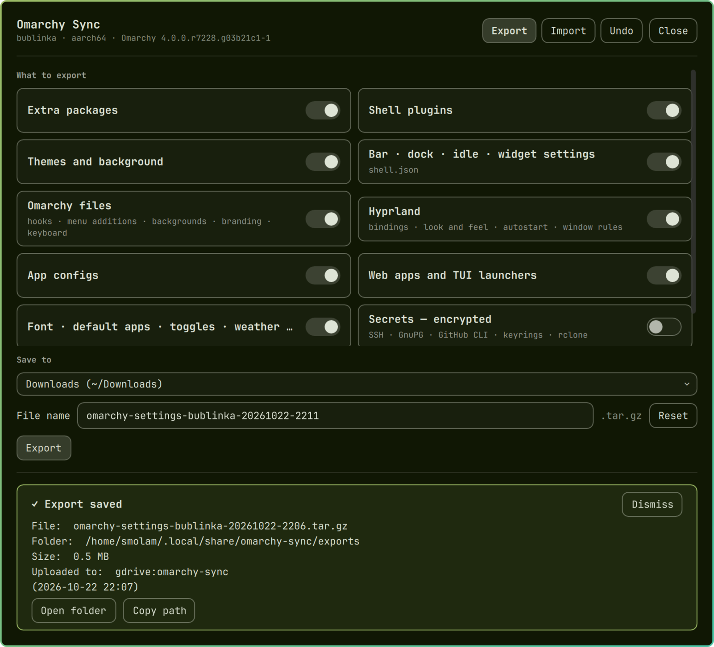

# Omarchy Sync

Carry your Omarchy setup to another Omarchy computer. **Export** writes everything you changed into one file; put it on a USB key, in Downloads or (with rclone) on Google Drive. **Import** on the other computer shows what would change, backs up every file it replaces, and applies the rest. It works between aarch64 and x86_64: packages are checked one by one against the new computer's repositories, and anything that isn't available for that CPU is listed, not forced.



## Install

```sh
omarchy plugin add https://github.com/smolamSK/omarchy-sync.git --enable
```

A few seconds after the plugin is enabled you'll find **Omarchy Sync** in the app launcher, and one notification. Click the notification if you also want **Setup → Sync Settings → Export… / Import… / Undo Last Import / Terminal Wizard** in the Omarchy menu. The plugin doesn't touch your menu file without that click. You can add the rows later with `omarchy-sync menu install`, or remove them with `omarchy-sync menu remove`. To bind a key to the window, use `omarchy-shell shell toggle io.github.smolamsk.sync`.

## What travels

| Section | What | How it's applied |
|---|---|---|
| `packages` | packages you installed beyond Omarchy's defaults (`pacman -Qqe` minus `omarchy-pkg-defaults`), split into repo and AUR; kernels, boot loader, keyrings, firmware and Omarchy's own packages never travel | each one is checked here: repo → `omarchy-pkg-add`, AUR → `omarchy-pkg-aur-add`, neither → listed as *not available for this CPU* with similar names |
| `plugins` | each shell plugin's git origin (and any files you changed locally); plugins that aren't git clones are copied whole | `omarchy plugin add URL --yes`; your local changes are laid over a fresh clone, which must pass `omarchy plugin validate` |
| `theme` | the current theme and background; git themes as their URL, your own themes as files | cloned (without switching to each one), then `omarchy-theme-set` and the same background picked by name |
| `shell` | `~/.config/omarchy/shell.json`: bar layout, widgets and their settings, dock, idle | merged into this computer's file; widgets of plugins that aren't installed are left out; values whose key looks like a key/token/password go to the encrypted secrets instead |
| `omarchy` | your hooks, menu additions, backgrounds, branding, templates, keyboard layouts, language | files copied; menu additions go into a fenced block of `omarchy-menu.jsonc` |
| `hypr` | `~/.config/hypr` files you changed | copied; `monitors.lua` and `input.lua` describe *that* computer's screens and touchpad, so they are only copied when you ask (`--include-hardware`) or when you import on the same computer |
| `apps` | the paths in `~/.config/omarchy-sync/apps.list` (btop, terminals, git, mise, starship, tmux, your fonts…; edit it freely) plus `~/.local/bin` scripts your bindings, hooks or menu call | copied; `mise install` afterwards if your mise config came along |
| `webapps` | launchers you made with *Install → Web App* or *TUI* (and their icons) | copied |
| `settings` | font, default terminal / editor / browser, look toggles, toggle flags, weather location | `omarchy-font-set`, `omarchy-default-* --install`, `omarchy-hyprland-toggle`, `omarchy-toggle` |
| `secrets` *(off unless you tick it)* | `~/.ssh`, `~/.gnupg`, `~/.config/gh`, `~/.local/share/keyrings`, `~/.config/rclone`, `~/.password-store`, and the key/token values from `shell.json` | encrypted with a passphrase inside the export (see Safety); restored with private permissions |

Between aarch64 and x86_64, paths in copied files that point at the other CPU's build of a tool (like a git credential helper at `~/.local/share/mise/installs/gh/…/gh_…_linux_arm64/bin/gh`) are pointed at this computer's build when it exists here or mise installs it; any that can't be fixed are listed in the report.

Only files that differ from what Omarchy installed (`/etc/skel`) are exported, so a fresh Omarchy on the other side keeps its own newer defaults for everything you never touched.

**Never exported:** browser profiles, caches, `.git` folders, files over 25 MB, Omarchy's migration markers and the generated current theme. The things Try Omarchy (the Mac VM app) adds are also left out: its menu rows, VM-only toggles and the wallpaper link into `/usr/share`.

## Use

The launcher and the menu rows open the **Omarchy Sync window**, a native Omarchy overlay with three tabs:

- **Export**: section switches, *Choose packages* to leave some out, two passphrase fields when Secrets is on, *Save to* (USB drives, Downloads, your rclone remote, or a path you type) and *File name*. Press **Export**.
- **Import**: pick an export file (USB drives, Downloads and earlier downloads are listed, or type a path; *Fetch newest from <remote>* downloads one with rclone). **Read** shows where it comes from and what it holds. Choose sections, type the passphrase if it has secrets, then **Preview changes** shows the plan and **Apply** carries it out after you confirm.
- **Undo**: the imports you can undo, newest first, and **Undo the last import**.

While it runs, a progress bar shows the step it's on (section by section on export, change by change on import). When it's done, a card says how it went: for an export the file name, folder, size and upload, with **Open folder** and **Copy path**; for an import how many changes were applied, skipped or failed, with **Undo this import**. *Show details* opens the full log. If the window is closed by then, a notification tells you instead. An import ends by restarting the Omarchy shell to load the new plugins and bar settings. With the window open, that waits until you close it (or press **Restart shell now**), so you can read the result first; with it closed, the shell restarts right away and the notification arrives once it's back. Adding plugins makes the shell reload its plugins, which closes the window for a moment; it opens again by itself.

The bottom of the window shows the progress and log. Escape closes the window but not a running export or import: it carries on, and reopening shows where it is. A run also carries on when the Omarchy shell reloads its plugins (an import that adds plugins makes it do that) or restarts. When package installs need your password, Omarchy's own password prompt (polkit) asks for it, since there is no terminal.

**Terminal Wizard** (or `omarchy-sync` in a terminal) offers the same steps as gum prompts:

- **Export**: tick the sections, untick packages you don't want carried, type a passphrase if you include secrets, then pick a USB drive, Downloads, an rclone remote or another folder.
- **Import**: pick an export (USB drives, Downloads and the rclone remote are searched), tick the sections, review the plan (`+` new, `~` changed, `–` skipped and why), confirm.
- **Undo Last Import** puts back every file the last import replaced or created.

### The export file

By default it's called `omarchy-settings-<hostname>-<YYYYmmdd-HHMM>.tar.gz`: the computer's name, then the local date and time to the minute, for example `omarchy-settings-bublinka-20261022-2121.tar.gz`. Change it in the window's *File name* field (*Reset* brings the default back), or with `omarchy-sync export -o ~/somewhere/any-name.tar.gz`. A renamed export is still found by Import, because the plugin recognises its own files by what's inside. In the rclone folder every `.tar.gz` counts.

### Command line

```
omarchy-sync                       the wizard
omarchy-sync export [-o PATH] [--sections a,b] [--secrets] [--push [REMOTE]]
omarchy-sync import FILE|--pull [REMOTE] [--dry-run] [--sections a,b] [--include-hardware] [--yes]
omarchy-sync push FILE [REMOTE]     upload with rclone (REMOTE like gdrive:omarchy-sync)
omarchy-sync pull [REMOTE] [-o DIR] download the newest export
omarchy-sync undo [BACKUP]          put back the files the last import replaced
omarchy-sync menu install|remove    the Omarchy menu rows
omarchy-sync sections               section names for --sections
omarchy-sync info --json            what the window reads: sections, places, rclone, exports, backups, packages
omarchy-sync inspect FILE --json    what an export holds, without applying it
```

Put `--events` before a command to get JSON-lines progress on stdout. `--passphrase-stdin` reads the secrets passphrase from stdin, `import FILE --plan-json` prints the plan as JSON, and `export --packages a,b` carries only those extra packages.

The command is `~/.config/omarchy/plugins/io.github.smolamsk.sync/bin/omarchy-sync`. Link it into `~/.local/bin` if you want it on your PATH. `--passphrase-file` lets scripts export or import secrets without a prompt.

### Google Drive and other clouds

The wizard uses [rclone](https://rclone.org), offering to install it when it is missing. Set up a remote once with `rclone config` (for example `gdrive`, type *drive*), then pick it in the wizard. The folder you choose (default `omarchy-sync`) is remembered in `~/.config/omarchy-sync/config`. *Import → From an rclone remote* lists the exports there, newest first. If Google Drive is already synced into a local folder, just pick that folder instead. If an upload fails because the remote is no longer signed in (its token expired, or it didn't survive a move to a new computer), the window says so and offers **Fix: rclone config reconnect gdrive:**. That opens a terminal to sign in again; then export again. The file itself is already saved locally in `~/.local/share/omarchy-sync/exports/`.

## Safety

- Before an import changes anything, every file it replaces is copied to `~/.local/share/omarchy-sync/backups/<time>/`, and `omarchy-sync undo` restores them. Packages, plugins and themes the import installed stay; remove them in the usual way if you don't want them.
- Each step reports its own result; one failure (a package missing for this CPU, a plugin that no longer validates) doesn't stop the rest.
- The export file is private (mode 600), and staging happens in `$XDG_RUNTIME_DIR`. The archive's checksums are verified before anything is applied, and an export from a newer version of this plugin is refused.
- Secrets are only ever written encrypted: gpg, AES-256, with the passphrase stretched by salted, iterated SHA-512 at gpg's highest iteration count, so guessing passphrases is as slow as gpg can make it. The passphrase goes to gpg through a pipe, never on a command line or in the environment. Nothing logs file contents.
- Every other file is checked for things that look like secrets before it goes into the plain part: tokens in known formats (GitHub, GitLab, `sk-…` API keys, Slack, AWS, Google), private keys, URLs with a password, and `NAME=value` lines where the name says token, secret, password, API key and so on (`$VAR`, `$(command)` and placeholders don't count). Such a file, say a `.bashrc` that exports `GITHUB_TOKEN`, moves into the encrypted secrets when you export those, and is left out otherwise. The report names the file, line and kind of secret, never the value.
- Everything else in the export is plain: your configs, package list, hostname and username. Keep the file somewhere private.

## Limits

- An import replaces your *changed* files wholesale: a binding you added only on the target computer is replaced by the exported `bindings.lua` (the old file is in the backup). Merge by hand from the backup if you need both.
- Exports from a much older Omarchy can carry Hyprland files written for an older format. The plan shows both Omarchy versions.
- Some toggles also start or stop a service (idle, night light); the flag is set and Hyprland reloaded, but a re-login may be needed for those.
- `/etc` settings (locale, time zone, DNS, the pacman channel) and anything outside your home folder are not carried.

## License

GPL-2.0-or-later.
